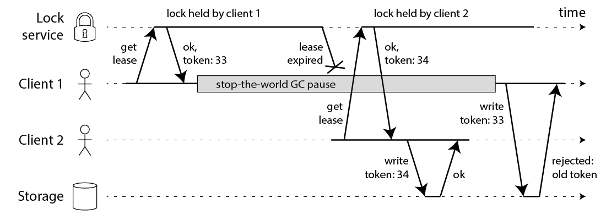

# pg-fenced-lease

[](https://github.com/rainlanguage/pg-fenced-lease/actions/workflows/ci.yml)
[](https://crates.io/crates/pg-fenced-lease)
[](https://docs.rs/pg-fenced-lease)
[](#license)

One owner per background job across instances, for Rust services on
Postgres and sqlx. Built for setups that run two copies at once, such as
Cloud Run with `--min=1 --max=2`, where revisions overlap during a deploy.

## The principle




Diagrams from Martin Kleppmann,
[How to do distributed locking](https://martin.kleppmann.com/2016/02/08/how-to-do-distributed-locking.html)
(2016), under [CC BY 3.0](https://creativecommons.org/licenses/by/3.0/).
In this crate, the lock service and the storage are the same Postgres
database, and the token is the lease row's `epoch`.

## Use

```toml
[dependencies]
pg-fenced-lease = "0.1"
# features = ["any"] for sqlx::AnyPool
# The crate brings no sqlx runtime; your own sqlx line must enable one.
sqlx = { version = "0.8", features = ["runtime-tokio", "postgres"] }
```

```rust
const LEASES: pg_fenced_lease::Config = pg_fenced_lease::Config::new("leases");

// Once, or as a migration: LEASES.create_table_sql()
pg_fenced_lease::ensure_table(&pool, &LEASES).await?;

// In the background job supervisor:
pg_fenced_lease::run_exclusive(&pool, &LEASES, "indexer", run_indexer()).await?;

// Everywhere the job writes:
let mut tx = pg_fenced_lease::write_transaction(&pool).await?;
// ... writes ...
tx.commit().await?;
```

Defaults: 30s TTL, 10s renewal, 1s standby retry.

## Things to know

- **Spawned tasks are not fenced.** The fence lives in a tokio `task_local`,
  and `tokio::spawn` drops it. Use `spawn_fenced` or `carry_fence`.
- **Only fenced transactions are safe.** Writes straight on the pool skip
  the check. Run the fence first in the transaction.
- **Writes outside a job are allowed.** HTTP handlers are not fenced, on
  purpose.
- **Takeover after a crash takes up to one TTL.** After a clean finish, or
  when the job future is dropped, it is about immediate.
- **Renewals use your pool.** A pool that stays exhausted for a whole TTL
  costs the job its lease.
- **Never delete lease rows.** Deleting a row restarts its epoch at 1. Do
  not add a unique index on any column but `name`.

## Tests

```bash
docker run --rm -d -p 5432:5432 -e POSTGRES_PASSWORD=pg postgres:17
DATABASE_URL=postgres://postgres:pg@localhost:5432/postgres cargo test --all-features
```

They cover two contenders, a clean hand-over, a dropped holder, a holder
that stops renewing (through a TCP proxy that goes silent), a stale write
refused after a takeover, a stolen lease cancelling the job, renewals going
through while the leader has a write open, a takeover waiting for the old
leader's open write, spawned tasks, and the `Any` driver. CI runs them on
Postgres 14 and 17.

## License

Licensed under either of [Apache License, Version 2.0](LICENSE-APACHE) or
[MIT license](LICENSE-MIT) at your option.

Unless you explicitly state otherwise, any contribution you submit for
inclusion in this crate, as defined in the Apache-2.0 license, is dual
licensed as above, without any additional terms or conditions.
